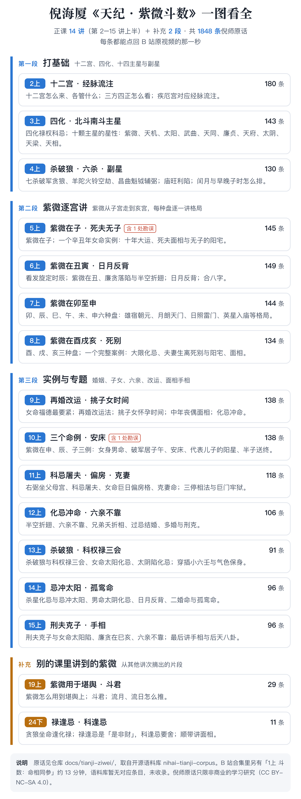

*Dịch sang tiếng Việt từ bản tiếng Trung [docs/tianji-ziwei/README.md](https://github.com/Renhuai123/ziwei-doushu/blob/main/docs/tianji-ziwei/README.md) của dự án gốc. Nội dung thư mục này theo CC BY-NC-SA 4.0; bản dịch cũng theo cùng giấy phép.*

# Lời nguyên văn trong 《Thiên Kỷ · Tử Vi Đẩu Số》 (天纪·紫微斗数) của Nghê Hải Hạ (倪海厦)

Đây là lời nguyên văn của thầy Nghê Hải Hạ (倪海厦) trong **phần Tử Vi Đẩu Số** của khóa 《Thiên Kỷ》 (天纪), gồm **1848 mục**, được sắp xếp theo từng buổi giảng. Mỗi mục đều kèm mốc thời gian dẫn nguồn; bấm vào là nhảy về đúng giây đó trong video gốc trên Bilibili, bạn có thể tự đối chiếu.

Nội dung lấy từ repo chị em [nihai-tianji-corpus](https://github.com/Renhuai123/nihai-tianji-corpus) (kho ngữ liệu Thiên Kỷ đầy đủ, commit `462faa4`); thư mục này chỉ là bản chia theo buổi giảng của phần Tử Vi, **nội dung lấy kho ngữ liệu làm chuẩn** và sẽ được đồng bộ cập nhật theo kho ngữ liệu.



## Phạm vi thu thập

- **Tử Vi Đẩu Số 14 buổi**: từ 2上 đến 15上, thu thập đầy đủ, tổng cộng 1808 mục.
- **Bổ sung 1**: 19上 đoạn 2–4, gồm ứng dụng Tử Vi trong khám dư (堪舆, phong thủy), Đẩu Quân (斗君), Lưu nguyệt (流月) và Lưu nhật (流日), tổng cộng 29 mục.
- **Bổ sung 2**: các đoạn nói về Tử Vi trong 24下, tổng cộng 11 mục.

Không thu thập:

- **Đoạn nói về Đẩu Số trong 1上 (mệnh và tướng tham chiếu lẫn nhau)**: trong ngữ liệu bản hoàn chỉnh của 《Thiên Kỷ》 không có mục tương ứng.
- **Bản gỡ băng nguyên văn từng chữ đầy đủ**: chỉ thu các đoạn trích ngắn lời nguyên văn của Nghê sư kèm nguồn, không chứa bản gỡ băng có thể phục dựng cả buổi học.
- **Ảnh chụp video và mọi nội dung nghe nhìn**: mọi nguồn dẫn đều là liên kết tới trang video gốc trên Bilibili.

## Mục lục theo buổi giảng

| Buổi | Nội dung | Số mục | Tệp |
|---|---|---|---|
| 2上 | Thập nhị cung (十二宫) / sơ đồ kinh mạch lưu chú (经脉流注图) | 180 | [2上.md](./2上.md) |
| 3上 | Tứ Hóa tinh (四化星) / Bắc Đẩu tinh hệ (北斗星系) / Nam Đẩu tinh hệ (南斗星系) | 143 | [3上.md](./3上.md) |
| 4上 | Nam Đẩu tinh hệ / Lục sát tinh (六杀星) / Phụ tinh (副星) / Tổng cách (总格) / Ly nhật tuyệt nhật (离日绝日) | 130 | [4上.md](./4上.md) |
| 5上 | Tử Vi tại Tý (紫微在子) / Tử phu (死夫) / Vô tử trạch (无子宅) | 145 | [5上.md](./5上.md) |
| 6上 | Phát toàn định giờ sinh (发旋定时辰) / Tử Vi tại Sửu / Nhật nguyệt phản bối (日月反背) / Hợp bát tự (合八字) / Tử Vi tại Dần | 149 | [6上.md](./6上.md) |
| 7上 | Tử Vi tại Mão / Thìn / Tỵ / Ngọ / Mùi / Thân | 144 | [7上.md](./7上.md) |
| 8上 | Tử Vi tại Dậu / Tuất / Hợi / Phu thê sinh ly tử biệt (夫妻生离死别) | 134 | [8上.md](./8上.md) |
| 9上 | Phép đổi vận khi tái hôn (再婚改运法) / Chọn thời điểm sinh con (挑子女时间) / Tướng mặt người góa bụa trung niên (中年丧偶面相) / Hóa Kỵ xung Mệnh (化忌冲命) | 138 | [9上.md](./9上.md) |
| 10上 | Ví dụ Tử Vi tại Thân / Thìn / Tý / Nữ thân nam mệnh (女身男命) / Phá Quân cư Tý Ngọ (破军居子午) / An giường (安床) / Tính cách Sát Phá Lang (杀破狼) / Kết hôn muộn (晚婚) / Dương tinh đại diện con trai (代表儿子的阳星) / Bán tử tống chung (半子送终) | 138 | [10上.md](./10上.md) |
| 11上 | Hữu Bật tọa cung Phụ Mẫu (右弼坐父母宫) / Khoa Kỵ đồ phu (科忌屠夫) / Nữ mệnh Cự Nhật thiên phòng cách (女命巨日偏房格) / Mệnh khắc vợ (克妻命) | 118 | [11上.md](./11上.md) |
| 12上 | Hóa Kỵ xung Mệnh / Lục thân bất kháo (六亲不靠) / Tướng anh em chết yểu (兄弟夭折相) / Qua Kỵ kết hôn (过忌结婚) / Đa hôn (多婚) | 106 | [12上.md](./12上.md) |
| 13上 | Sát Phá Lang / Khoa Quyền Lộc tam hội (科权禄三会) / Tiểu Lục Nhâm (小六壬) / Thái Âm hãm Hóa Kỵ (太阴陷化忌) / Hồng Loan Thiên Hỉ Hóa Kỵ (红鸾天喜化忌) | 91 | [13上.md](./13上.md) |
| 14上 | Kỵ xung Thái Dương (忌冲太阳) / Nam mệnh Thái Âm hãm (男命太阴陷) / Thái Âm Hóa Kỵ nhập Mệnh (太阴化忌入命) / Cô Loan mệnh (孤鸾命) | 96 | [14上.md](./14上.md) |
| 15上 | Hình phu khắc tử (刑夫剋子) / Nữ mệnh Thái Dương hãm (女命太阳陷) / Liêm Tham tại Tỵ Hợi (廉贪在巳亥) / Lục thân bất kháo / Xem chỉ tay (手相) | 96 | [15上.md](./15上.md) |
| 19上 | Bổ sung 1 (19上 đoạn 2–4: ứng dụng Tử Vi trong khám dư, Đẩu Quân, Lưu nguyệt Lưu nhật) | 29 | [19上_补充1.md](./19上_补充1.md) |
| 24下 | Bổ sung 2 (đoạn nói về Tử Vi trong 24下) | 11 | [24下_补充2.md](./24下_补充2.md) |

## Mỗi mục trông như thế nào

```
- [00:36:09](https://www.bilibili.com/video/BV1KJsLekEfA?p=9&t=2169) 「倪师原话」〔考据标注〕　册目
```

- **Thời gian**: thời điểm câu nói này bắt đầu trong tập video đó; bấm vào là phát từ đúng giây này.
- **Trong 「」**: lời nguyên văn của Nghê sư. Chỉ bỏ từ đệm khẩu ngữ và nhiễu do nhận dạng, thêm dấu câu, không sửa chữ.
- **Trong 〔〕**: chú thích khảo cứu.
  - Lỗi chữ trong phụ đề đã được phân xử và sửa thì ghi là «đã sửa theo phân xử: chữ sai→chữ đúng» (已按裁决改正：错字→正字).
  - Lỗi nói nhầm trong phần giảng của Nghê sư, được xác nhận qua tính toán lập lá số, ghi là «đính chính: ……» (勘误：……), lời gốc vẫn giữ nguyên. Hiện có một chỗ ở 5上, liên quan 4 mục; xem giải thích ở [trang đính chính của kho ngữ liệu](https://github.com/Renhuai123/nihai-tianji-corpus/blob/main/docs/%E5%8B%98%E8%AF%AF.md).
- **Sách mục (册目)**: vị trí của câu nói này trong hệ thống mười một cuốn của kho ngữ liệu, ví dụ «Chính tinh › Tử Vi · định tính» (主星 › 紫微 · 定性).

`entries.jsonl` là phiên bản đọc được bằng máy của cùng nội dung này, mỗi dòng một mục, các trường giống kho ngữ liệu; giải thích xem [mô tả các trường của kho ngữ liệu](https://github.com/Renhuai123/nihai-tianji-corpus/blob/main/data/schema.md).

## Giấy phép

Thư mục này dùng **CC BY-NC-SA 4.0**: được trích dẫn, đăng lại, nhưng phải ghi nguồn; **không được dùng cho mục đích thương mại**; tác phẩm phái sinh phải dùng cùng giấy phép. Thư mục này không áp dụng MIT và CC BY 4.0 ở thư mục gốc của repo; chi tiết xem [LICENSE.md](./LICENSE.md).

## Bản quyền và lời cảm ơn

- Bản quyền nội dung khóa 《Thiên Kỷ》 thuộc về **thầy Nghê Hải Hạ và những người kế thừa quyền lợi của thầy**.
- Các đoạn trích trong thư mục này là **lời kể nguyên văn của Nghê sư**. Việc chỉnh lý lấy video công khai trên Bilibili làm tư liệu, qua nhận dạng chữ, đối chiếu chéo bằng hai engine nhận dạng giọng nói và đính chính thủ công; các việc liên quan đã được trao đổi với người đăng tải video và họ đã biết.
- Liên kết nguồn trỏ tới trang video gốc trên Bilibili, thuận tiện cho độc giả xem lại đối chiếu, đồng thời mang lượt truy cập về cho video gốc.
- Nếu bên giữ quyền có phản đối với bất kỳ nội dung nào, sau khi nhận được thông báo chúng tôi sẽ **gỡ ngay** phần tương ứng.

Nội dung thuộc tư liệu nghiên cứu và học tập văn hóa truyền thống, không cấu thành bất kỳ lời khuyên nào về y tế, đầu tư hay quyết định cuộc đời.
